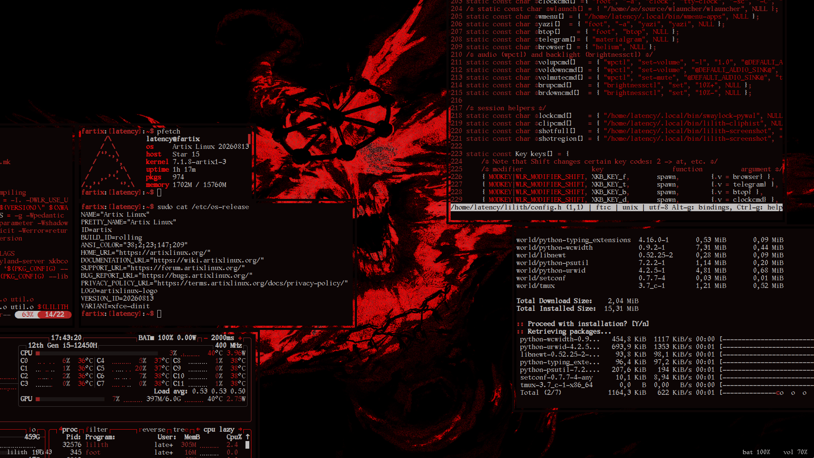
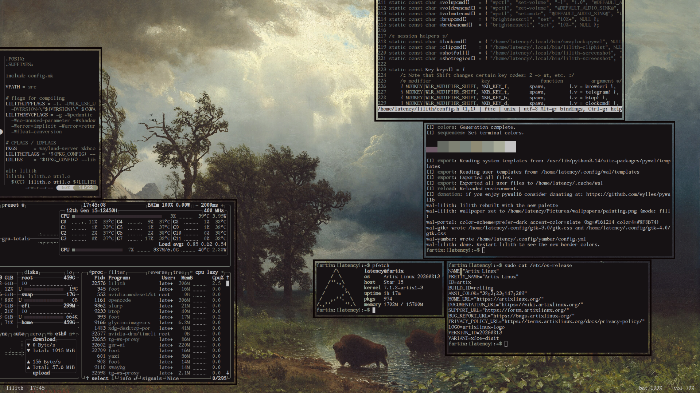
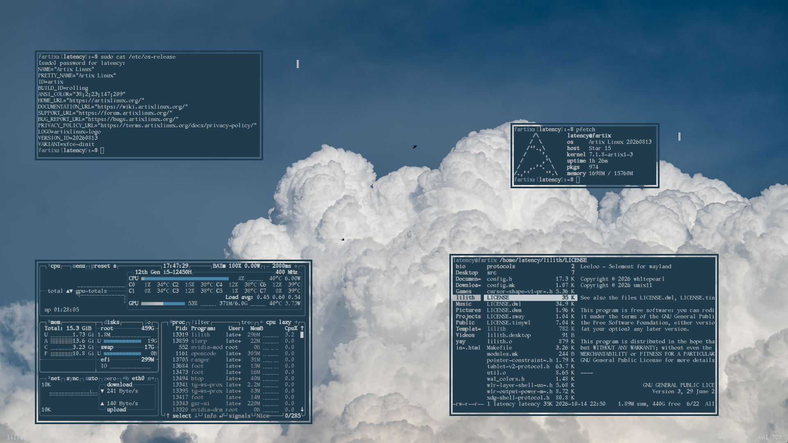
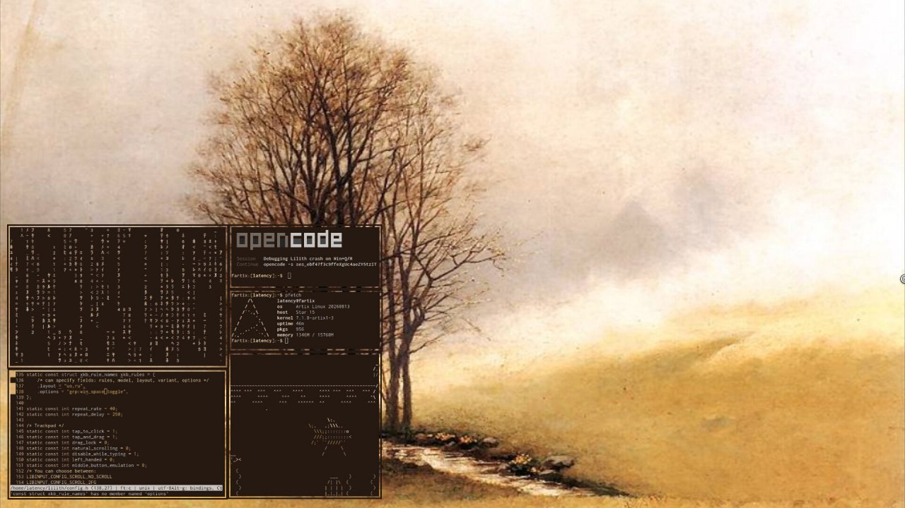

# lilith rice

**Rice by [@ceapeapea](https://github.com/ceapeapea).**
The [lilith](https://github.com/ohto121/lilith) compositor itself is by
[ohto121](https://github.com/ohto121): free-floating windows on an endless
zoomable canvas with a built-in status bar.

| | |
| --- | --- |
|  |  |
|  |  |

Everything follows **one pywal16 palette** generated from the wallpaper:
compositor borders, the built-in bar, foot, GTK3/4, Qt6 (qt6ct), dunst.
The wallpaper is drawn by `swaybg`, and the palette is compiled into the
compositor — restart lilith after a change and everything switches colour.

## What's inside

```
bin/            session + helper scripts (lilith-session, wal-*, wmenu-apps, ...)
lilith/         the compositor part of the rice: config.h + config/, and rice.patch
config/foot/    foot terminal
config/wmenu/   launcher app filter (wmenu-apps)
config/wal-templates/  pywal16 templates — the source of all colours
config/gtk-3.0, gtk-4.0/  settings.ini (Adwaita + prefer-dark)
config/qt6ct/   Qt6 theming (Fusion + pywal scheme)
```

The compositor part (`lilith/config/`) does: pywal colours for every border
and the bar (no focus highlight; focused border = background), the built-in
bar on the bottom (transparent, Gallant font, `lilith HH:MM` left, tags in
the middle, battery + volume on the right), and all keybinds.

## Install (Arch/Artix)

Build:

```
base-devel wlroots0.19 libinput libxkbcommon libdrm fcft pixman \
xorg-server-xwayland xcb-util-wm
```

Runtime (`pywal16` is in the AUR):

```
pywal16 foot wmenu dunst swaybg swayidle swaylock cliphist wl-clipboard \
grim slurp brightnessctl polkit-gnome qt6ct ttf-nerd-fonts-symbols
```

Font everywhere is **Gallant Raster Term** (put the .ttf into
`~/.local/share/fonts`), with **Symbols Nerd Font** as the icon fallback.

1. Compositor:

```
git clone https://github.com/ohto121/lilith ~/lilith-compositor
cd ~/lilith-compositor
git apply /path/to/this-repo/lilith/rice.patch   # or copy lilith/config.h and lilith/config/ over the clone
```

2. Dotfiles:

```
mkdir -p ~/.local/bin ~/.config
cp bin/* ~/.local/bin/
cp -r config/foot config/wmenu config/gtk-3.0 config/gtk-4.0 config/qt6ct ~/.config/
cp -r config/wal-templates ~/.config/wal/templates
```

3. Pick a wallpaper — the palette is generated from it, everything recolours,
and the compositor rebuilds:

```
wal-lilith ~/Pictures/wallpapers/your-image.png
```

4. Start the session from a TTY: `~/.local/bin/lilith` (= `lilith-session`:
finds and rebuilds the compositor if the palette changed, applies GTK/Qt
theming, autostarts dunst, swayidle, the clipboard watcher and friends).

## Keys (the rice defaults)

- **Win+Q** terminal, **Win+R** launcher (wmenu-apps), **Win+C** close,
  **Win+F** fullscreen, **Win+Shift+F** helium
- **Win+Shift+E** yazi, **Win+Shift+B** btop, **Win+Shift+D** tty-clock
- **Win+Z** zoom to fit all windows, **Win+=**/**Win+-** canvas zoom
- **Win+WASD** focus, **Win+Tab** center a window, **Win+Home** canvas home
- **Win+1..9** tags, **Win+B** toggle the bar, **Win+L** lock
- Print / **Win+Shift+S** screenshots (save + clipboard + notification),
  **Win+V** clipboard history
- Left-drag on the canvas pans it, **Win+left-drag** moves a window,
  **Win+right-drag** resizes, scroll zooms, markers like `Win+Shift+Left`
  pan the canvas by keyboard.

## How the palette plumbing works

- `wal-lilith <image>` runs pywal16 on the image → `~/.cache/wal/lilith-colors.h`
  (rendered from `config/wal-templates/lilith-colors.h`), sets the wallpaper
  via swaybg, copies the header into the compositor source tree and rebuilds.
- `wal-gtk` / `wal-qt` recolour GTK and Qt from the same palette at every
  login and wallpaper change.
- `lilith-session` finds the compositor source (`~/lilith-compositor` by
  default, override with `LILITHDIR`), rebuilds it if the palette changed,
  and only then starts the session.
